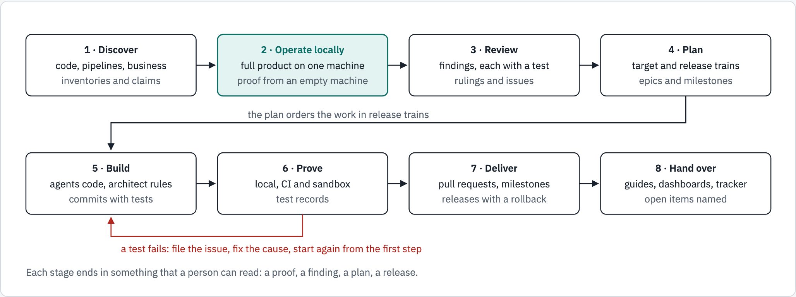
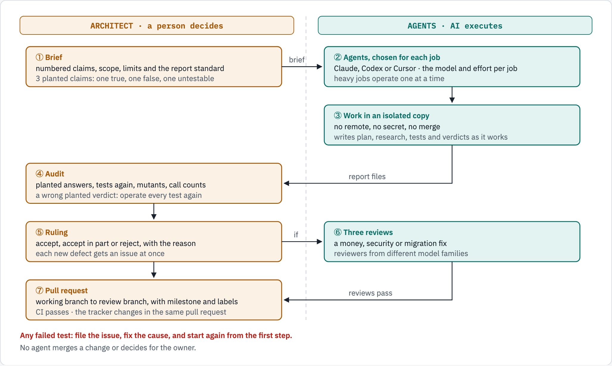
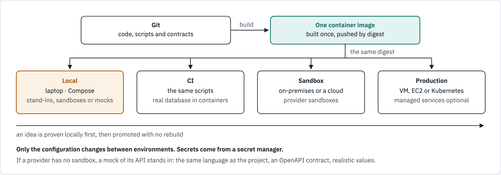
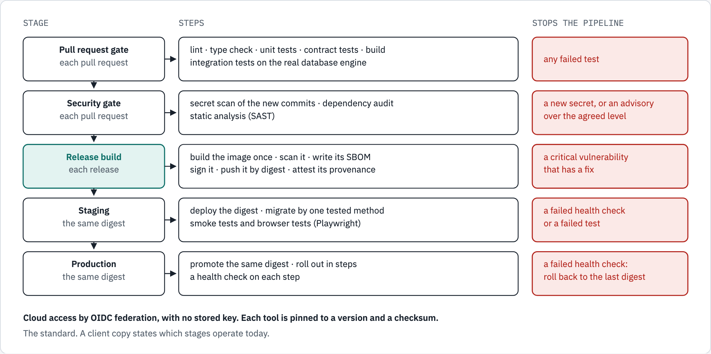
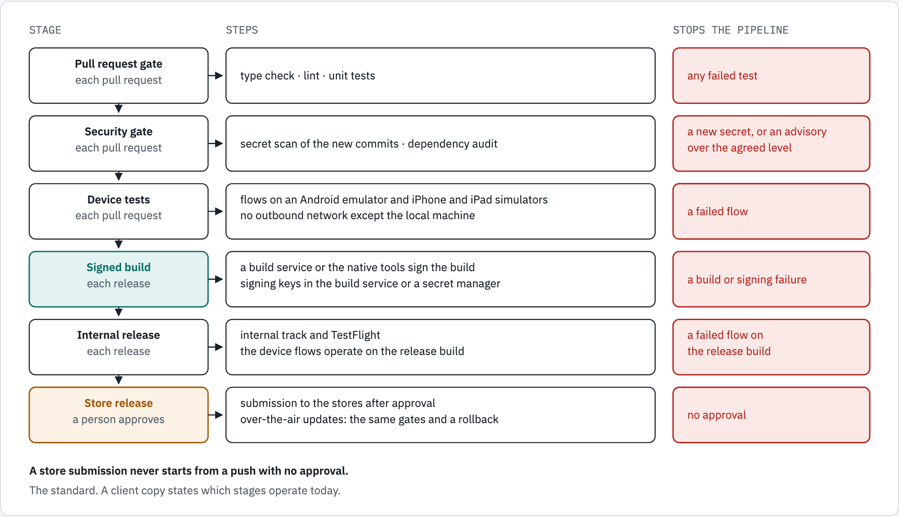

## What we do

- We review, design, build, test and deliver software with one team of people and AI agents.
- A senior architect sets the technical vision and makes each decision.
- AI agents from more than one vendor do the review, the analysis, the code and the tests.
- The architect audits each agent result before the team accepts it.
- Each claim and each number has a source that a person can read.

## Principles

- Local first: the product operates on a laptop, and the same scripts then deploy it anywhere.
- Evidence first: each claim comes from a command, a test or a record.
- Adversarial by default: each claim about the code is attacked.
- People decide, agents execute: no agent merges a change.
- No vendor lock-in: open standards and portable containers.
- Creative use of open source: one port, an adapter for each store, one contract test suite.
- Contract first, secure by design, observable by design, traceable delivery.

## Services

- Adversarial security audit
- Architecture review of a monolith or of services
- Modernization and microservices, with no vendor lock-in
- Standalone services for an existing application or a new design
- Identity and secrets: OIDC, JWT, mutual TLS, workload identity
- CI/CD and the software supply chain: scans, SBOM, signatures
- Observability, APM and KPIs, in open formats
- Runtime and scaling: virtual machines, cloud or Kubernetes, with KEDA
- Local product copy and API mocks, automated testing, agile delivery

## The engagement lifecycle

## The review and build loop

## Local first

## API mocks when a provider has no sandbox

- The mock uses the main programming language of the project.
- It follows the public API documentation and contract of the provider.
- It checks the API key and the credentials as the provider does, with test values only.
- Each provider has an OpenAPI contract, a data model and the unit of each field.
- Each answer has realistic values, so the product operates end to end.
- Scenarios give failures on demand: a timeout, an error code, a slow answer.
- Contract tests compare the mock and the client with the contract.
- A real sandbox stays the recommendation.

## CI/CD for a web application or an API

## CI/CD for a mobile application

## How CI/CD operates

- GitHub Actions operates each pipeline.
- Each workflow calls the deploy scripts of its repository.
- The same scripts operate on a developer machine first.
- CI operates on each branch and each pull request of the branch flow.
- On Kubernetes, Argo CD deploys from Git. With no Kubernetes, the deploy script operates on the target.

## Migrations and the move to new environments

- One migration run for each release, under a lock, after a snapshot of the managed database
- Expand, then contract one release later. Each process refuses to serve below a schema floor
- Compose: a one-shot service on the first host. Kubernetes: PreSync hook Jobs in sync waves
- New environments beside the current one, from one module and a parameter file each
- Staging with synthetic data. Pre-prod in safe mode, with repeated production loads
- Cutover: lower the TTL, freeze, final load, migrate, switch DNS, hold, retire

## Identity, transport security and secrets

- Sign-in: OIDC with PKCE. Keycloak is the standard. A cloud provider, for example Amazon Cognito, is an option.
- Tokens: each API checks the JWT signature, issuer, audience, expiry and algorithm.
- Service to service: mutual TLS where it is necessary, with automatic rotation.
- Secrets: workload identity, a secret manager, External Secrets on Kubernetes, and no secret in code.

## Observability, APM and KPIs

- OpenTelemetry in each service: automatic and code instrumentation. Traces, metrics and logs in OTLP.
- Open source back ends, or a managed APM through the same collector.
- RED metrics for each service, USE metrics for each resource.
- System KPIs with service level objectives. Business KPIs from a review of the business functions.
- Alerts start from a measured baseline, and each alert has a runbook.
- KPI facts and alert rules in PostgreSQL. The admin portal shows the dashboards and sets each threshold.
- The portal BFF calls the API through Envoy. Administrators sign in with MFA.

## Runtime and scaling

- One OCI image operates on a virtual machine, a cloud virtual machine or Kubernetes.
- Compose on virtual machines. Helm and Argo CD on Kubernetes.
- KEDA scales each workload on a measured signal.
- Capacity follows the measured load. Managed services are an option.

## Testing

- Unit, integration on the real database engine, contract and API tests.
- Browser tests with Playwright. Mobile flows with Maestro on emulators and simulators.
- Load tests with k6. Mutation tests during each audit.
- The same tests operate on a laptop and in CI.
- Each failure gets an issue, and the test starts again from step 1.

## Agile delivery

- Milestone: a release train, with a date and a rollback. It is never a parent.
- Epic, then feature, then story, task or spike, linked as GitHub sub-issues.
- Each item has a GitHub issue type, a type label and one status label.
- A defect is a sub-issue of the issue under which it was found.
- Each pull request names its milestone, its issues and its class.
- The build tracker shows the milestone, the class and the status of each issue.
- Waves give the dates. Stages run from mockup to draft, build, review, merged and released.

## From an idea to a release

| Item | Issue type | ID | Class |
|---|---|---|---|
| Feature | Feature | Finding ID or `INV-nn` | `INV` |
| Story | Feature | Finding ID, `INV-nn` or `TDT-nn` | As the work |
| Task, spike | Task | Finding ID or `TDT-nn` | As the work |
| Defect | Bug | `SEC`, `BUG`, `PERF`, `UX` | `TDT` for a cause in debt |
| Owner action | Task | `OA-nn` | None |

## Legend: findings

| Prefix | Category |
|---|---|
| `SEC` | Security |
| `BUG` | Bug |
| `PERF` | Performance |
| `BP` | Best practice |
| `UX` | User experience |
| `OA` | Owner action |
| `MG` | Migration |
| `INV` | Innovation, from no finding |
| `TDT` | Tech debt, from no finding |

## Legend: classes

- A class says what kind of work an item is. An ID never changes.
- `INV`, label `class:INV`: the work adds something new to the product or the delivery.
- Examples of `INV` are a feature, a service, a security control, a test method and a CI/CD gate.
- `TDT`, label `class:TDT`: the setup works today, but an earlier shortcut makes it cost more to change.
- An item can have one class, both classes or none.
- If the fix of a defect only restores existing behavior, the defect has no class.
- Sweep the classes of all issues after each change of this rule.

## Legend: severity, status and verdicts

- Severity, one `sev:` label on each defect: Critical, High, Medium or Low.
- Status, one `status:` label on each open issue: Open, Partly fixed, Fixed on the review branch or Owner action.
- Closed: the fix reached the default branch.
- Verdict of each claim: CONFIRMED, REFUTED, PLAUSIBLE or NOT REACHED.

## What the client gets

- The Adversarial Review, Architecture and Implementation Report: the detailed document of the engagement.
- It holds the findings, the architecture, the work that was built, the tests, the fixes and a phased roadmap.
- Its summary highlights the innovations, built and proposed, and the class of each issue.
- Issues, epics and milestones that match the roadmap.
- The product on a laptop, with sandboxes or API mocks.
- Pipelines, test suites, dashboards and alerts.
- Figures, guides and runbooks made from the code at a named commit.
