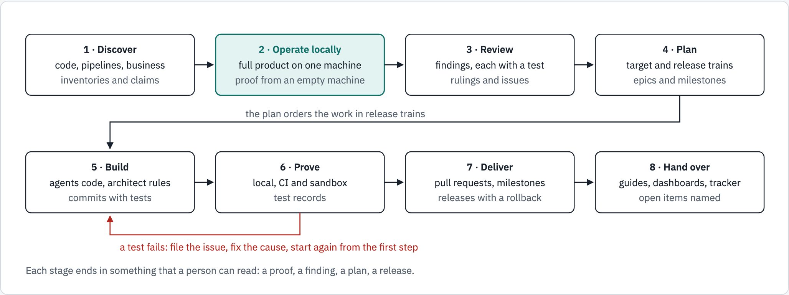
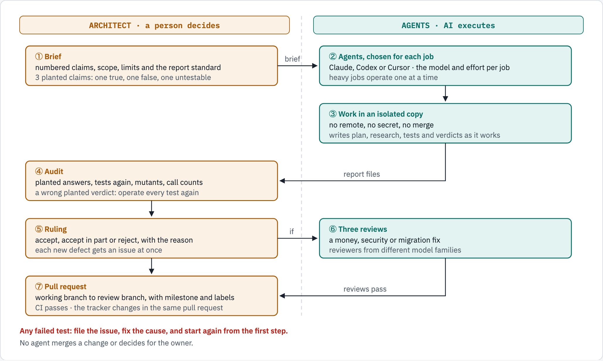
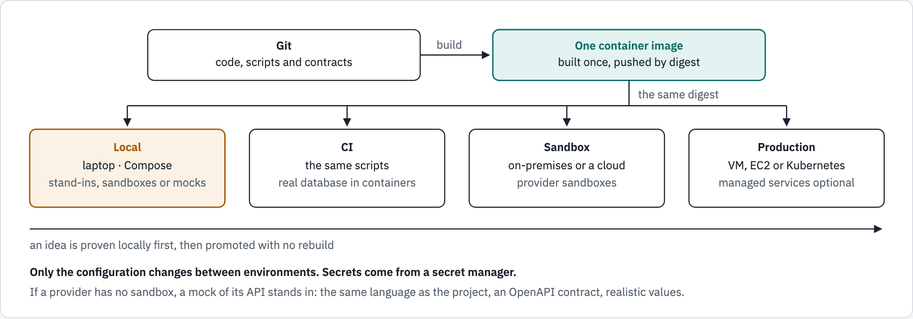
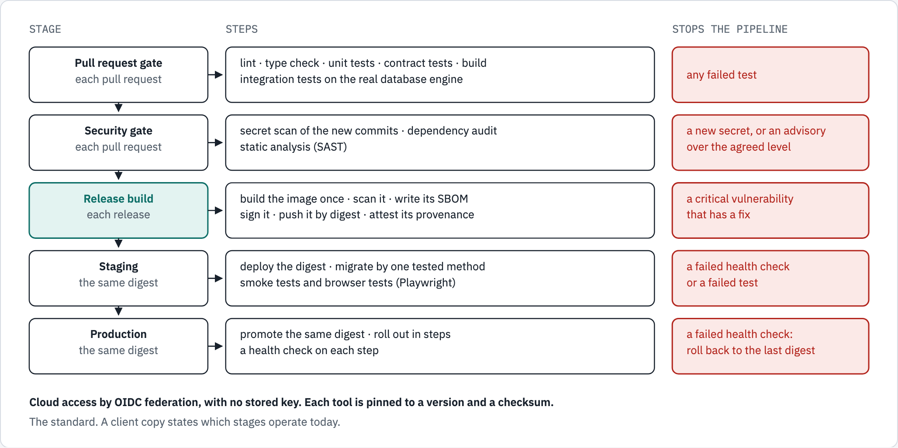
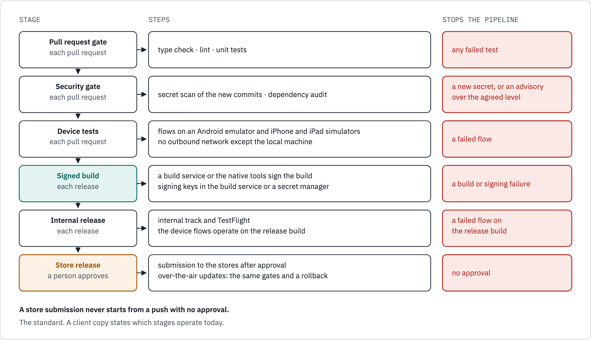

## 1. What this playbook is

This playbook states how we review, design, build, test and deliver software. It is the same for each client. A client copy adds the facts of that client: what operates today, what is proposed, and the proof of each step.

We work as one team of people and AI agents. A senior architect sets the technical vision, writes each brief and makes each decision. This is human-guided engineering. AI agents from more than one vendor do the review, the analysis, the code and the tests. This is AI-guided engineering. The architect audits each agent result before the team accepts it.

The playbook has three parts:

- Sections 2 to 4 give the principles, the services and the lifecycle of an engagement.
- Sections 5 to 13 give the standard for each area of the work, with a figure where the order matters.
- Section 14 gives the legend that every report, issue and figure uses.

With this playbook, each client gets a detailed document: the Adversarial Review, Architecture and Implementation Report. It holds the findings and their proof, the current and the target architecture, the work that was built and tested, and a phased roadmap. Its summary shows the class of each issue and the innovations, built and proposed. It uses the legend of section 14.

## 2. Principles

| Principle | What it means | How we prove it |
|---|---|---|
| Local first | A well-built application operates on a developer machine. This local copy is the base of each stage of the software development life cycle (SDLC). The same scripts build, deploy and test it locally, and then in a real environment, on-premises or in a cloud | A full proof from an empty machine, with exit 0 at each stage |
| Evidence first | Each claim, number and status comes from a command, a test or a record that the document names | The source of each statement is in the document |
| Adversarial by default | Each claim about the code is attacked. Only what a test supports stays | A test that fails before a fix and passes after it |
| People decide, agents execute | The architect decides. Agents test claims, write code and report. No agent merges a change | A written ruling for each agent job |
| No vendor lock-in | Open standards and portable containers. A managed service is an option behind an interface, not a dependency | The same image operates on a virtual machine, a cloud virtual machine and Kubernetes |
| Creative use of open source | Combine open-source components to give a feature that a managed service does not have. One port (an interface in the code) has an adapter for each store or service, and the configuration chooses the adapter. The licence of each component is recorded: open source, or source-available with its limits | One contract test suite passes against each adapter |
| Contract first | Each API has an OpenAPI contract and a data model. A mock follows the contract | Contract tests on the client side and on the server side |
| Secure by design | Standard identity, short-lived credentials, encryption in transit and no secret in code | Security tests in CI and an adversarial audit |
| Observable by design | Open formats for traces, metrics and logs. Alerts on measured values | A dashboard and an alert for each key performance indicator (KPI) |
| Traceable delivery | Each change has an issue, a milestone, a pull request and a tracker row | The tracker reads its values from the issue system |

For example, a managed PostgreSQL service can lack the TimescaleDB extension. The product then has one time-series port with two adapters. One adapter uses TimescaleDB on a host that the team runs, with hypertables and continuous aggregates. The other uses plain PostgreSQL with native partitions, on any PostgreSQL or a managed service. The same contract test suite passes against both, so the team can change the store with one configuration value.

## 3. Services

| Service | What the client gets |
|---|---|
| Adversarial security audit | Findings with a severity, a test, a fix and a user story. Reviewers from different model families attack each claim |
| Architecture review | A review of a monolith or of services: inventories, a twelve-factor scorecard, the current and the target architecture, and a phased roadmap with a proof for each step |
| Modernization and microservices | Refactoring, a pluggable design with no vendor lock-in, and a split into services where a measured need supports it. Each new function is secure and scales |
| Standalone services | A new service for an existing application or a new design, with its own store, its contract and its view in the admin portal. An example is a fraud analytics service |
| Identity and secrets | OpenID Connect (OIDC) sign-in, JSON Web Token (JWT) rules, mutual TLS where it is necessary, and secret management with workload identity |
| CI/CD and the software supply chain | Pipelines with tests, scans, a software bill of materials (SBOM), image signatures and deploy by digest |
| Observability, APM and KPIs | OpenTelemetry instrumentation, application performance monitoring (APM), dashboards, and alerts on system and business KPIs |
| Error tracking and APM, with GlitchTip first | GlitchTip, or Sentry as the option (hosted or self-hosted), installed by the method of each deploy target. GlitchTip recommends 512 MB of RAM, and self-hosted Sentry needs 4 CPU cores and 16 GB. A module of the admin portal shows the errors, the alerts and the KPIs, with a link to each item in the provider. The module sits in the middle. It reads the issues, events and alerts of the provider. It sends each one as an OpenTelemetry log record over OTLP to the logging solution of the client, for example VictoriaLogs |
| Custom integrations and an extended admin portal | Integrations that add what a tool does not give, for example a collector for the fired alerts of GlitchTip, which have no API. Each one comes with a contract, a test and a view in the admin portal |
| Runtime and scaling | Containers that operate on virtual machines, cloud virtual machines or Kubernetes, with autoscaling on measured load |
| Local product copy and API mocks | The full product on one machine, with provider sandboxes or a mock of each external API |
| Automated testing | Unit, integration, contract, API, browser, mobile, load and mutation tests, on a laptop and in CI |
| Agile delivery | Epics, milestones, features, stories, tasks and defects, linked to each pull request and to a build tracker |
| Documentation and diagrams | The Adversarial Review, Architecture and Implementation Report, guides, runbooks, figures and dashboards, made from the code at a named commit |

## 4. The engagement lifecycle

<!-- markdownlint-disable MD033 -->
<picture>
  <source media="(prefers-color-scheme: dark)" srcset="figures/lifecycle.dark.png">
  
</picture>
<!-- markdownlint-enable MD033 -->

*Figure 1. The engagement lifecycle. Eight stages, from discovery to hand-over. The product operates locally at stage 2, before the review. A failed test at stage 6 sends the work back to stage 5.*

| Stage | What happens | What it delivers |
|---|---|---|
| 1. Discover | Read the code, the pipelines, the infrastructure and the business functions | Inventories and the list of claims to test |
| 2. Operate locally | Make the product operate on one machine, with sandboxes or mocks | The local copy and its proof |
| 3. Review | Attack the claims with agents of different model families | Findings, each with a test |
| 4. Plan | Design the target and order the work in release trains | The architecture, the roadmap, the epics and the milestones |
| 5. Build | Agents write the code from briefs. The architect audits and rules | Commits with tests |
| 6. Prove | Operate the tests locally, in CI and in a sandbox | Test records with 0 failures |
| 7. Deliver | Merge through pull requests with milestones, and release in order | Releases with a rollback |
| 8. Hand over | Give the documents, the dashboards and the open items | Guides, runbooks and the tracker |

If a test fails at stage 6, the work goes back to stage 5. Each defect gets an issue at once.

## 5. The review and build loop

<!-- markdownlint-disable MD033 -->
<picture>
  <source media="(prefers-color-scheme: dark)" srcset="figures/review-loop.dark.png">
  
</picture>
<!-- markdownlint-enable MD033 -->

*Figure 2. The review and build loop. The architect writes the brief, audits the result and rules. Agents from several vendors do the work in isolated copies. Money, security and migration fixes get three reviews.*

1. The architect writes a brief. The brief gives the numbered claims, the scope, the limits and the report standard.
2. The brief has three planted claims with answers that only the architect knows: one true, one false and one that the agent cannot test.
3. The architect chooses the agent for each job: the vendor, the model and the reasoning effort. Heavy jobs operate one at a time.
4. The agent works in an isolated copy with no remote and no secret. It writes its plan, research, tests, verdicts and fixes to files as it works.
5. The architect audits the job. The audit compares the planted answers and operates each test again. It adds mutants, which are deliberate faults that a good test must catch. It also counts the calls in the agent log.
6. The architect writes a ruling for each finding. A new defect gets an issue at once.
7. A fix to money, security or a database migration gets three reviews from different model families.
8. The change goes through a pull request from a working branch, with its milestone and labels. CI must pass before the merge.
9. The tracker changes in the same pull request.

The test loop: operate the whole test from its first step. At the first failure, file the issue, fix the cause, and start again from step 1. Only one full run with 0 failures ends the loop.

## 6. Local first

<!-- markdownlint-disable MD033 -->
<picture>
  <source media="(prefers-color-scheme: dark)" srcset="figures/local-first.dark.png">
  
</picture>
<!-- markdownlint-enable MD033 -->

*Figure 3. One build, the same scripts, four environments. The product operates on a laptop first. The same image and scripts then operate in CI, in a sandbox and in production, on-premises or in a cloud.*

A well-built application operates locally. The team proves an idea on the local copy before it pays for an environment. The same container image and the same scripts then operate in CI, in a sandbox and in production, on-premises or in a cloud. Only the configuration changes between environments.

The local copy has stand-ins for each platform service:

| Platform service | Local stand-in |
|---|---|
| Database | The same engine and major version as production, in a container |
| Cache and queues | The same protocol, in a container |
| Object storage | An S3-compatible server |
| Email | A mail catcher |
| Identity provider | Keycloak |
| Telemetry | An OpenTelemetry collector, Prometheus and Grafana |
| Edge proxy | The same proxy as production, for example Envoy |

If an external provider has a sandbox, use the sandbox. If it has no sandbox, build a mock of its API:

- The mock uses the main programming language of the project, so the same team can read, change and test it.
- The team models the mock on the public API documentation and the API contract of each provider, not on the calls that the client makes. The mock then gives the real app experience, and a client call that differs from the contract fails a test.
- The mock checks authentication as the provider does: the API key, the credentials, the token exchange and the signature of each webhook. It accepts only test values of the same form, never a real key.
- Each provider has an OpenAPI contract with its paths, its data model and the units of each field.
- Each answer has realistic values, so the product operates end to end.
- Scenarios give failures on demand: a timeout, an error code, a slow answer and a duplicate webhook.
- An inspection page shows the request log and the state.
- Contract tests compare the mock answers and the client calls with the contract.
- The contract marks each field that no provider document states. A sandbox answer removes the mark.

A mock is a stand-in. The recommendation for real sandboxes stays.

## 7. CI/CD for a web application or an API

<!-- markdownlint-disable MD033 -->
<picture>
  <source media="(prefers-color-scheme: dark)" srcset="figures/pipeline-web.dark.png">
  
</picture>
<!-- markdownlint-enable MD033 -->

*Figure 4. The pipeline for a web application or an API. Five stages. The image is built and signed once, and the same digest moves to staging and to production. Each stage names what stops it.*

| Stage | Steps | What stops the pipeline |
|---|---|---|
| Pull request gate | Lint, type check, unit tests, integration tests on the real database engine, contract tests and a build | Any failed test |
| Security gate | A secret scan of the new commits, a dependency audit and static analysis | A new secret, or a new advisory over the agreed level |
| Release build | Build the container image once. Scan it. Write its SBOM. Sign it. Push it by digest, with a provenance attestation | A critical vulnerability that has a fix |
| Staging | Deploy the digest. Apply migrations by one tested method. Operate smoke and browser tests | A failed health check or test |
| Production | Promote the same digest. Roll out in steps with health checks | A failed health check starts the rollback to the last digest |

The pipeline operates in GitHub Actions. Each workflow calls the deploy scripts that the repository holds beside it. The same scripts build, deploy and test the product on a developer machine, so the local copy tests each deploy before CI operates it. CI operates on each branch and on each pull request of the branch flow: a working branch, the integration branch, the staging branch and the default branch.

If the product operates on Kubernetes, Argo CD deploys from Git. The workflow writes the new image digest to the deployment repository, and Argo CD applies it and shows any difference from Git. If the product operates with no Kubernetes, the workflow operates the deploy script on the target, for example Compose on a virtual machine.

The pipeline gets cloud access through OIDC federation, with no stored key. Each action and tool is pinned to a version and a checksum. A merge to a deploy branch needs a reviewed pull request and passed checks.

### Schema migrations, backups and the move to new environments

Each task of this kind gets an `MG` ID. A migration fix gets three reviews, as section 5 says.

| Part | The standard method |
|---|---|
| Schema history | Versioned migrations, recorded in a history table. One run for each release, under a database lock, before the new code takes traffic. If an entity changes with no migration, a CI test fails |
| Copy before each run | On a managed database, a snapshot through the provider API, and a wait until it is available. Locally, a dump with a checksum. Keep the last copies, and alert on a stale one |
| Old code on a new schema | Expand first, and contract one release after the code stops using the old shape. Each process refuses to serve below a schema floor, and only a contract change raises the floor. A rolling deploy then keeps the old hosts ready |
| Restore | A restore tool lists, checks and restores a copy, and keeps the live set first. A copy with a newer floor than the build is refused. The keys that the data needs come back through the secret store |
| Release | A migration ships only with a new app version. A route gives the image, the app version and the schema floor |

The starter of each step depends on the target. The database stays managed on both.

| Step | A virtual machine with Compose | Kubernetes with Argo CD |
|---|---|---|
| Copy | The deploy workflow takes the snapshot with the cloud CLI and its waiter | A PreSync hook Job in an early sync wave, with a role that can only take and read snapshots |
| Migration | A one-shot service, started once on the first host, before the rollout | A PreSync hook Job in a later wave, with the release image digest |
| A failed migration | The workflow stops, and the old containers serve | Argo CD stops the sync, and the old pods serve |

Hooks do not run during a selective sync. Do not use selective sync for a release that requires a migration. Source: [resource hooks](https://argo-cd.readthedocs.io/en/stable/user-guide/resource_hooks/#selective-sync).

To move a product to new infrastructure, build the new environments beside the current one, and change nothing in the current one until the cutover:

1. Bootstrap once: the owner makes the state store and the CI roles. After that, only CI applies infrastructure.
2. One infrastructure module builds each environment. A parameter file selects new resources, or existing ones by ID.
3. Staging gets synthetic data only, provider sandbox keys and the end-to-end suites of each product, the mobile app included.
4. Pre-prod is production grade, with a new URL. It starts in safe mode: no worker, no scheduled jobs, sandbox keys and no webhooks.
5. Load a production dump into pre-prod, migrate it, and prove it: times, row counts and money totals. Repeat until the window is known. If the window is too long, use logical replication.
6. An internal mobile build with its own app ID uses the pre-prod URL. Test on phones and emulators until one full run has 0 failures.
7. Cut over by a rehearsed runbook: lower the DNS TTL, freeze writes, load the final dump, migrate, turn off safe mode in order, and switch DNS. Keep the old environment with no traffic for a hold period, then retire it.

## 8. CI/CD for a mobile application

<!-- markdownlint-disable MD033 -->
<picture>
  <source media="(prefers-color-scheme: dark)" srcset="figures/pipeline-mobile.dark.png">
  
</picture>
<!-- markdownlint-enable MD033 -->

*Figure 5. The pipeline for a mobile application. Six stages. Device flows operate on emulators and simulators before the build and again on the release build. A person approves each store submission.*

| Stage | Steps | What stops the pipeline |
|---|---|---|
| Pull request gate | Type check, lint and unit tests | Any failed test |
| Security gate | A secret scan of the new commits and a dependency audit | A new secret, or a new advisory over the agreed level |
| Device tests | Flows on an Android emulator and on iPhone and iPad simulators, with no outbound network except the local machine | A failed flow |
| Signed build | A build service or the native tools make signed builds. Signing keys stay in the build service or a secret manager | A build or signing failure |
| Internal release | An internal track and TestFlight. The device flows operate on the release build | A failed flow on the release build |
| Store release | A person approves the submission. Over-the-air updates pass the same gates and have a rollback | No approval |

The mobile pipeline also operates in GitHub Actions. Its local scripts start the emulators and the simulators and operate the same device flows on a developer machine.

A store submission never starts from a push with no approval.

## 9. Identity, transport security and secrets

| Area | Standard |
|---|---|
| Sign-in | OIDC with the authorization code flow and PKCE (proof key for code exchange). Keycloak is the standard identity provider. A cloud provider, for example Amazon Cognito or Microsoft Entra ID, is an option behind the same OIDC interface. Administrators use a second factor |
| Tokens | Each API checks the JWT signature against the published keys, and the issuer, audience, expiry and algorithm. Access tokens are short-lived. Refresh tokens rotate, and a sign-out revokes them |
| Service to service | Mutual TLS where services share a network that the client does not fully control, or where a regulator requires it. Certificates rotate automatically |
| Secrets | No secret in code, in an image or in a log. A workload gets its cloud access from its identity, not from a stored key. Secrets come from a secret manager, through External Secrets on Kubernetes. Secrets rotate, and CI scans each commit |

## 10. Observability, APM and KPIs

| Area | Standard |
|---|---|
| Instrumentation | The OpenTelemetry SDK in each service, and the OpenTelemetry collector. Automatic instrumentation covers HTTP, the framework and the database. Code instrumentation adds spans and metrics for each business step. Traces, metrics and logs use OTLP, the open OpenTelemetry protocol |
| Libraries that we build | A library that we build or publish instruments itself, so that its user writes no instrumentation code. It depends only on the OpenTelemetry API, and it works with no SDK installed. It emits spans and metrics with the names of the OpenTelemetry semantic conventions, and structured logs in the OpenTelemetry logs data model. It gives a route to Prometheus. No key, value or personal data goes in any signal, and the user can turn off each signal |
| Back ends | Open source back ends, for example Prometheus or VictoriaMetrics for metrics, Loki or VictoriaLogs for logs, and Tempo or VictoriaTraces for traces. Grafana gives the dashboards of the engineers, and Perses gives them where the platform console uses it, for example OpenShift. A managed APM service is an option through the same collector. A change of back end needs no change of code |
| Service metrics | RED for each service: rate, errors and duration. USE for each resource: the share in use, the saturation and the errors |
| KPIs | System KPIs, for example availability and latency, each with a service level objective. Business KPIs come from a review of the business functions, for example completed payments or new sign-ups |
| KPI store | The service also writes its KPI facts, its alert rules and its alert events to its own PostgreSQL database. The admin portal reads them with the access control of the product, and no new store is necessary |
| Alerts | Each alert starts from a measured baseline and has a runbook. An alert names the KPI and the threshold. The rules cover system and business KPIs. An administrator with the write permission changes a threshold in the admin portal, and the API records each change |
| Error tracking | GlitchTip is the recommendation, because of its resource needs, and Sentry is the option. One setting selects the provider for each app. The SDKs are the open source Sentry SDKs, which send to GlitchTip or Sentry. The admin portal reads the provider data on the server side, from a cache in Valkey or PostgreSQL, and never waits for the provider |
| Error tracker data in the logging solution | An APM module in the middle reads the issues, events and alerts of GlitchTip (database, API and webhooks) or Sentry (API and signed webhooks). It sends each one as an OpenTelemetry log record over OTLP. The records go through the OpenTelemetry Collector, or straight to a solution that accepts OTLP, for example VictoriaLogs at `/insert/opentelemetry/v1/logs`. No converter is necessary. GlitchTip and Sentry do not send this data there themselves: hosted Sentry forwards processed error events only to Segment, Amazon SQS and Splunk. Each step has a defined error and retry rule |
| Admin portal | The admin portal shows the dashboards of the KPIs and the RED metrics from end to end. Its backend for frontend (BFF) calls the API through the edge proxy, for example Envoy. Administrators sign in with a second factor (MFA) |

A dashboard starts with an inventory of each metric that the workload emits. The dashboard then shows only the metrics that answer a question that a user asks.

## 11. Runtime and scaling

- Each service is an OCI container image. The same image operates on a virtual machine, on a cloud virtual machine with Compose, or on Kubernetes with Helm.
- On Kubernetes, Argo CD deploys from Git. KEDA scales each workload on a measured signal, for example the request rate or the queue depth.
- The capacity follows the measured load. A managed service is an option, not a requirement.
- On Kubernetes, the network layer is Cilium. It gives eBPF network policy from L3 to L7 and transparent encryption between nodes. Its service mesh uses a shared Envoy on each node, with no sidecar.
- For more than one cluster, Cilium ClusterMesh joins them. A Service with the same name in each cluster and the annotation `service.cilium.io/global: "true"` balances across the clusters. The annotation `service.cilium.io/affinity: "local"` keeps traffic in the cluster while a local backend is healthy.
- Hubble shows each flow, and its metrics go to Prometheus. With exemplars on, each HTTP metric carries its trace ID, so Grafana goes from a metric to the trace in Tempo. The `/dashboard` skill makes the Grafana dashboards for these metrics. Sources for trace export and the Grafana link: [trace setup](https://grafana.com/docs/tempo/latest/set-up-for-tracing/), [exemplar links](https://grafana.com/docs/grafana/latest/datasources/prometheus/configure/#exemplars).

## 12. Testing

| Level | Tools | Where it operates |
|---|---|---|
| Unit | The test runner of the language | Laptop and CI |
| Integration | The real database engine and cache, in containers | Laptop and CI |
| Contract | OpenAPI contracts and the mock app | Laptop and CI |
| API | HTTP tests against the local stack | Laptop and CI |
| Browser | Playwright with Chromium | Laptop, CI and staging |
| Mobile | Maestro on Android emulators and iOS simulators | Laptop and CI where the runner permits |
| Load | k6 | Laptop and staging |
| Mutation | Deliberate faults that the tests must catch | During each audit |
| Security | Scanners in CI, and the adversarial audit | CI and each review |

## 13. Agile delivery

Each piece of work has one record on GitHub, from the idea to the release. The `/agile` skill gives the template of each item, its issue type and the commands that create it. The `/pull-request` skill gives the template of each change.

| Item | Meaning | GitHub issue type | Parent |
|---|---|---|---|
| Milestone | A release train: the set of changes that ships together, with a date and a rollback | Not an issue | None. Each issue names one milestone |
| Epic | A goal with child issues and exit criteria | `Epic` where the organization has it | None |
| Feature | A capability that a user sees | `Feature` | An epic |
| Story | One slice of a feature for one role, with acceptance criteria | `Feature` | A feature or an epic |
| Task and spike | A step of work, or a time-boxed question with a measured answer | `Task` | A feature or an epic |
| Defect | A fault, filed at once with how to prove it | `Bug` | The issue under which it was found |
| Owner action | Work that needs an account, a key, a plan or a decision that code cannot supply | `Task` | The issue that waits for it |

The parent link is a GitHub sub-issue, and the body also says `Part of #<parent>`. A milestone is never a parent. Each issue has one type label, one `status:` label, and the class labels of section 14.

Each pull request uses the template of its repository. It names its milestone, its issues and its class. The build tracker shows the milestone, the class and the status of each issue, and it changes in the same pull request as the work.

Each milestone has a due date. One GitHub Project holds the items of all repositories: its field `Wave` gives the dates of the work, and its field `Stage` shows how far each item is. The stages are Mockup, Draft, Build, Review, Merged and Released, and each has an exit rule. The definition of done of each story and task names each stage. A roadmap view shows the waves and the milestone dates.

## 14. Legend

Every report, issue, pull request and figure uses this legend. `skill/agile/LEGEND.md` holds the same legend with its labels. Each finding ID has a prefix and a number. The prefix gives the category. The number does not give an order of priority. An ID never changes after it is filed.

| Prefix | Category | Meaning |
|---|---|---|
| `SEC` | Security | A person can get data, money or access that they must not have |
| `BUG` | Bug | The code gives an incorrect result |
| `PERF` | Performance | Speed, capacity, scaling or measurement of the service |
| `BP` | Best practice | A gap in how the team builds, tests, deploys or operates the code |
| `UX` | User experience | A defect that a user sees on the screen |
| `OA` | Owner action | Work that needs an account, a key, a plan or a decision that code cannot supply |
| `MG` | Migration | A task that moves a schema, data or a whole environment to a new version or a new place: a migration, the copy before it, a data load or a cutover |
| `MA` | Mock app | A story of a mock app: a stand-in for an external API, with its contract |
| `APM` | Application performance monitoring | A story or task of error tracking and APM: the provider, the alerts, the KPIs and their view in the admin portal |
| `INV` | Innovation | A new feature, design, idea or method that comes from no finding |
| `TDT` | Tech debt | A debt item that comes from no finding |

A class says what kind of work an item is. Each item of any prefix can have one class, both classes or no class. The prefix names the body of work, and the class names its kind. For example, an `APM` task that adds a new alert collector has the class `INV`. A finding keeps its ID and gets a class label. If the fix of a defect brings existing behavior back to its intended form and adds nothing, the defect has no class. If the fix adds a new control, such as a webhook signature, a second factor, an allow-list or a scan, the defect is `INV`. A defect in new `INV` work that is not merged yet is also `INV`, because its fix is part of that work. A defect in an unmerged fix that has no class keeps no class. Sweep the classes of all issues at the first classification and after each change of this rule, not only the classes of new issues.

| Class | Label | Meaning |
|---|---|---|
| `INV` | `class:INV` | Innovation: the work adds something new to the product or the delivery. Examples are a feature, a service, a security control, a test method and a CI/CD gate |
| `TDT` | `class:TDT` | Tech debt: the code or the setup works today, but an earlier shortcut makes it cost more to change, operate or upgrade |

| Severity | Meaning |
|---|---|
| Critical | A person with no special access can get money, data or control of a server now |
| High | If a condition occurs, for example a race or a stolen token, a person can get money, data or access |
| Medium | Incorrect data, a weak control or a slow service, with no direct loss |
| Low | A small defect, a defect that no code path reaches yet, or a cleanup |

| Status | Meaning |
|---|---|
| Open | No fix yet. A story describes the work |
| Fixed on the review branch | The fix and its test are merged on a branch that is not the default branch. Nothing is deployed |
| Partly fixed | Part of the work is fixed. The rest is a story or an owner action |
| Owner action | The work waits for the owner |
| Closed | The fix reached the default branch |

| Verdict | Meaning |
|---|---|
| CONFIRMED | A test supports the claim |
| REFUTED | A test shows that the claim is false |
| PLAUSIBLE | The evidence supports the claim, but no test proves it |
| NOT REACHED | No test is possible from where the agent operates |

| Figure element | Meaning |
|---|---|
| Solid box | Operates today |
| Dashed box | Proposed, not built |
| Solid arrow | Traffic or a call |
| Dashed arrow with a label | A relationship with no traffic |
| Red | A failure, a refusal or a finding |
